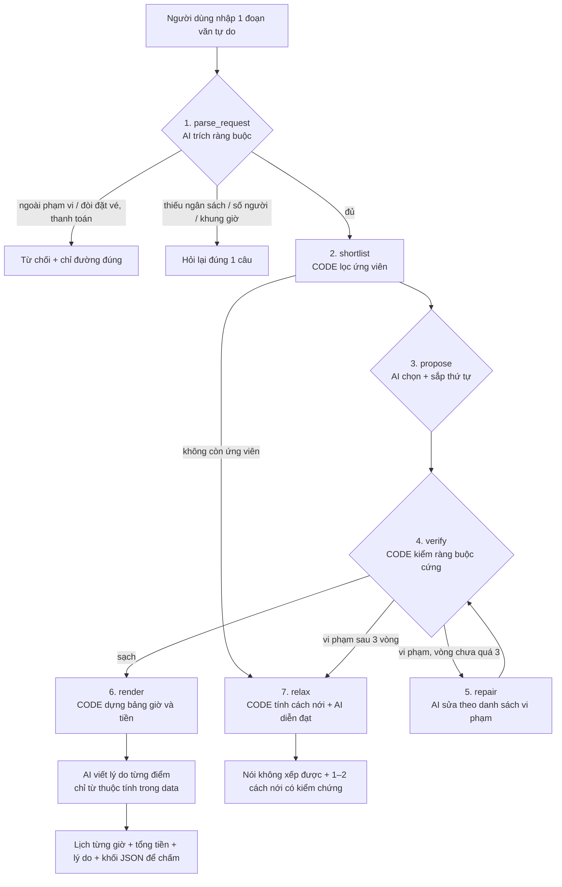
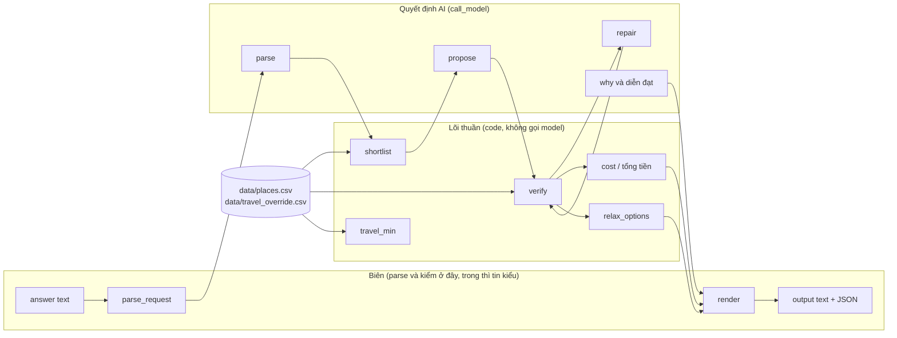

# Thiết kế: lịch trình 1 ngày ở Đà Nẵng vừa ngân sách

> Soạn theo phương pháp pstack (`architect`: phác 2 hình dạng rồi chọn · `model-the-domain` · `boundary-discipline` · `explain-the-number` · `sequence-verifiable-units`).
> Đây là **bản đề xuất của AI cho nhóm duyệt**. Số liệu chi phí là ước tính, phải đo lại bằng `python run.py simulate`. Dữ liệu địa điểm chưa có, nhóm tự dựng (xem mục 7).

## 1. Phạm vi lát cắt
> Một nhóm bạn trẻ đi lần đầu đến Đà Nẵng · nhập ngân sách, số người, khung giờ, sở thích · AI quyết định chọn và sắp thứ tự điểm tham quan và bữa ăn của 1 ngày, thoả giờ mở cửa, thời gian di chuyển và ngân sách, hoặc nói không xếp được · nhóm nhận lịch từng giờ kèm tổng tiền và lý do chọn.

**Không làm** (ghi cả ở `spec.md` §4): đặt vé / đặt bàn / thanh toán · chỗ ở · nhiều ngày · bản đồ tương tác · giá hay giờ mở thời gian thực · tỉnh ngoài Đà Nẵng.

**Phạm vi địa lý (đã chốt, gồm Hội An):** 5 cụm: (1) Biển Mỹ Khê – Ngũ Hành Sơn, (2) Sơn Trà, (3) Trung tâm (cầu Rồng, bảo tàng, chợ), (4) Bà Nà (xa, tốn nửa ngày), (5) Hội An (cụm xa, **đã chốt thuộc phạm vi**; nhóm kiểm lại địa giới hành chính từ nguồn chính thức trước khi ghi trong slide). Hải Vân để làm ca "ngoài dữ liệu hoặc quá xa". Câu từ chối "tỉnh khác" dùng nơi rõ ràng nằm ngoài, ví dụ Hà Giang.

## 2. Flow



**Bốn đường đi (khớp `spec.md` §6):**
- Suôn sẻ: parse → shortlist → propose → verify sạch → render.
- Không chắc (lớp 2: thiếu thông tin): hỏi lại đúng 1 câu, không đoán tiền hay số người.
- Không có căn cứ (lớp 1): địa điểm không có trong dữ liệu thì nói "chưa có dữ liệu", không bịa.
- Người dùng sửa: nhập lại yêu cầu (ví dụ "bỏ Bà Nà") → chạy lại từ bước 1 với ràng buộc mới.

## 3. Hai hình dạng đã cân nhắc (architect)

| | **A. Một agent, vòng lặp gọi công cụ** | **B. Workflow cố định + vòng sửa có giới hạn** *(chọn)* |
|---|---|---|
| Ai giữ trạng thái kế hoạch | Model tự giữ trong hội thoại | Điều phối viên (code) giữ một `Plan` duy nhất |
| Số lần gọi model | Không đoán trước | 2–5, biết trần |
| Kiểm ràng buộc | Model tự gọi hoặc quên gọi | Luôn chạy, không phụ thuộc model |
| Tái lập khi chấm | Khó, mỗi lần đi đường khác | Dễ, bước cố định |
| Chi phí | Cao, dễ lặp | Thấp, chặn được |

**Chọn B**, vì thứ tự việc đã biết trước (hiểu → lọc → chọn → kiểm → sửa → báo). Agent chỉ có ích khi đường đi không đoán được, mà ở đây thì đoán được. Không chọn nhiều agent: không có việc nào độc lập đủ để tách.

## 4. Kiến trúc



**Nguyên tắc (≥3, điền vào `spec.md` §4):**
| Nguyên tắc | Cụ thể |
|---|---|
| **Mỗi thứ một chủ** | Tiền, giờ, quãng đường chỉ do `cost`, `verify`, `travel_min` tính. Model không bao giờ tự nhẩm số. |
| **Biên chặt, lõi tin kiểu** | Đầu vào người dùng và JSON model trả đi qua `parse` và `validate_plan` ở biên. Trong lõi dùng kiểu có sẵn, không kiểm lặp. |
| **G10 · thu hẹp phạm vi khi không chắc** | Thiếu thông tin thì hỏi 1 câu. Không có lịch hợp lệ thì nói không xếp được, không đưa lịch gần đúng. |
| **Giải thích được con số** | Mọi số tiền, giờ trong đầu ra đều lần ngược được về dòng dữ liệu và ngày kiểm. |
| **Trạng thái không hợp lệ không biểu diễn được** | Giờ là số phút nguyên, địa điểm là `id` có trong dữ liệu, không là chuỗi tự do. |

## 5. Mô hình miền (Python, thư viện chuẩn)

```python
from dataclasses import dataclass
from typing import Literal

Kind = Literal["tham_quan", "an", "cafe"]

@dataclass(frozen=True)
class Place:
    id: str                      # "DN-014", khoá duy nhất
    name: str
    kind: Kind
    cluster: str                 # "my_khe", "son_tra", "trung_tam", "ba_na", "hoi_an"
    tags: tuple[str, ...]        # danh sách tag chốt ở data/DATA_CARD.md
    open_windows: tuple[tuple[int, int], ...]   # phút từ 00:00, ví dụ ((420,1260),)
    closed_days: tuple[int, ...]                # 0=Thứ Hai … 6=Chủ Nhật
    visit_min: int               # thời lượng ở lại tối thiểu
    price_pp: int                # VND / người (0 nếu miễn phí)
    price_basis: Literal["moi_nguoi", "ca_nhom"]
    source: str                  # link hoặc tên nguồn
    checked_on: str              # "2026-11-27"
    lat: float
    lon: float

@dataclass(frozen=True)
class Constraints:
    people: int
    budget_total: int            # VND cho cả nhóm: vé + ăn + di chuyển giữa các điểm (không gồm chỗ ở)
    day: int                     # thứ trong tuần
    start: int                   # phút
    end: int
    like: tuple[str, ...]
    avoid: tuple[str, ...]       # tag cần tránh, ví dụ "hai_san"
    base_cluster: str            # nơi ở, đầu vào cố định
    transport: str = "grab"      # "grab" (xe công nghệ, tính theo km) hoặc "xe_may" (thuê xe máy, tính theo ngày)

@dataclass(frozen=True)
class Stop:
    place_id: str
    arrive: int
    leave: int

@dataclass(frozen=True)
class Plan:
    stops: tuple[Stop, ...]

@dataclass(frozen=True)
class Violation:
    code: Literal["UNKNOWN_PLACE","CLOSED","OVERLAP","TRAVEL_GAP","OVER_BUDGET",
                  "OUT_OF_WINDOW","NO_MEAL","AVOID_TAG","TOO_MANY","DUPLICATE"]
    stop_index: int | None
    detail: str
```

**Vì sao thiết kế thế này:**
- `Plan` chỉ chứa `place_id` và giờ. Model không thể "tạo" một quán mới vì mọi `id` đều bị `verify` đối chiếu với dữ liệu (lỗi `UNKNOWN_PLACE`).
- Không có trường "tổng tiền" trong `Plan`. Tiền luôn là hàm của `Plan` và `Constraints`, nên không thể lệch khỏi các điểm đã chọn.

## 6. Hợp đồng module (`codebase/`)

| Hàm | Loại | Vào → Ra | Ghi chú |
|---|---|---|---|
| `parse_request(text) -> Constraints \| AskBack \| OutOfScope` | AI + biên | Văn bản → ràng buộc có kiểu | Model trả JSON, code kiểm kiểu và miền giá trị. Thiếu ngân sách, số người hoặc khung giờ → `AskBack(câu hỏi)`. Không điền mặc định cho tiền |
| `shortlist(c) -> list[Place]` | code | Ràng buộc → ≤15 ứng viên | Lọc: ngày đóng cửa, tag cần tránh, giá 1 điểm không quá ngân sách. Sắp theo khớp `like` |
| `propose(c, cands) -> Plan` | AI | Ứng viên → danh sách `Stop` | Model chỉ chọn `id` và giờ đến. Mọi thứ khác là code |
| `transport_cost(a, b, mode, people) -> int` | code, thuần | 2 điểm → tiền đi lại (VND) | Đơn giá lấy từ `data/transport_rates.csv` (ước tính, có nguồn và ngày kiểm). Km tính từ tọa độ × hệ số đường vòng, cùng nguồn với `travel_min`. `cost(plan, c)` = vé + ăn + Σ `transport_cost` |
| `verify(plan, c) -> list[Violation]` | code, thuần | Kế hoạch → danh sách vi phạm | Xem bảng luật bên dưới |
| `repair(plan, c, violations) -> Plan` | AI | Kèm danh sách lỗi cụ thể | Tối đa 3 vòng, ghi `note("dừng: …")` |
| `relax_options(c) -> list[Relax]` | code | Ràng buộc → cách nới đã kiểm | Thử nâng ngân sách, kéo dài khung giờ, bỏ 1 tag; chỉ trả cách nới mà `verify` thật sự qua |
| `render(plan, c, why) -> str` | code | Kế hoạch → bảng giờ | Giờ, tiền, đi lại lấy từ code. `why` do model viết |
| `answer(text) -> {"output": str}` | điều phối | Nguyên đoạn input của câu thử → đầu ra | Giữ nguyên hợp đồng của khung |

**Luật `verify` (chuẩn "đạt" cứng, kiểm bằng code):**
| Mã | Điều kiện vi phạm |
|---|---|
| `UNKNOWN_PLACE` | `place_id` không có trong `places.csv` |
| `CLOSED` | Khoảng `[arrive, leave]` không nằm trọn trong một `open_window`, hoặc ngày đóng cửa |
| `OVERLAP` / `TRAVEL_GAP` | `arrive[i+1] < leave[i] + travel_min(i, i+1)` |
| `OVER_BUDGET` | `Σ price × (people hoặc 1) + Σ transport_cost` > `budget_total` |
| `OUT_OF_WINDOW` | Có điểm ngoài `[start, end]` |
| `NO_MEAL` | Khung giờ người dùng giao khung trưa (11:00–14:00) hoặc khung tối (17:00–20:00) từ 90 phút trở lên mà không có bữa ăn tương ứng |
| `AVOID_TAG` | Có điểm mang tag trong `avoid` |
| `TOO_MANY` | Quá 6 điểm một ngày (đề xuất), hoặc `visit_min` bị rút ngắn |
| `DUPLICATE` | Lặp một địa điểm |

## 7. Dữ liệu cần dựng (tối nay)

`data/places.csv` (25–40 dòng) và `data/travel_override.csv` (chỉ vài cặp điểm cần ghi đè; còn lại `travel_min` tính từ tọa độ).
- **Thành phần:** khoảng 15–20 điểm tham quan + 12–18 quán / cafe, trải đều 5 cụm.
- **Mỗi dòng có nguồn và ngày kiểm.** Dùng thông tin công khai, nhập tay, không chép review (tối đa 2 câu theo luật data).
- **Cố ý có chỗ khó** (nhãn `synthetic` trong DATA_CARD nếu tự đặt): điểm đóng cửa sớm, điểm nghỉ 1 ngày trong tuần, quán nghỉ trưa, 1 điểm rất đắt, 1 điểm rất xa (Bà Nà), 2 quán trùng một tag, 1 quán chỉ mở tối.
- **`data/transport_rates.csv`** (2–3 dòng): `mode, base_vnd, per_km_vnd, per_day_vnd, source, checked_on`. Đơn giá phải lấy từ nguồn công khai, ghi **(tự ước tính)** trong DATA_CARD; không dùng làm bằng chứng pain.
- **`travel_min`:** tính từ tọa độ với tốc độ ước tính (ví dụ 25 km/h đô thị, nhân hệ số đường vòng) và ghi rõ đây là **ước tính, không phải số đo thật**. Có bảng ghi đè cho vài cặp quan trọng.
- **Không** coi dữ liệu này là bằng chứng pain.

## 8. Đánh giá

**Ba tầng, vì `run.py eval` không tự chấm cột `pass`:**
1. `eval/grade.py` (nhóm viết, thư viện chuẩn): đọc `output`, trích khối JSON, chạy `verify` và `cost`, điền `pass`. Đây là grader kiểu `code`.
2. Câu `tu_choi`: chấm bằng quy tắc (có từ chối + không có lịch).
3. Chất lượng mềm (hợp sở thích): 3 bạn chấm 10 mẫu, thang 1–5, chỉ báo cáo, không chốt ngưỡng cứng.

**Mẫu đầu ra** (để `grade.py` đọc được): cuối `output` có một khối ```json {"status":"plan|infeasible|ask_back|refuse","stops":[{"id":"DN-014","arrive":"09:30","leave":"11:00"}],"total_vnd":...,"relax":[{"change":"budget_total=450000","stops":[...]}]}``` (`relax` có khi `status=infeasible`, mỗi mục là một cách nới đã qua `verify`; các trạng thái khác để mảng rỗng).

**Bộ câu thử (khung 10 câu cho CP2, mở rộng 20–30 câu ở CP3):**
| Nhóm | Ví dụ | Loại |
|---|---|---|
| Suôn sẻ | 2 người, 800k, 8h–18h, thích biển và hải sản | thuong |
| Suôn sẻ | 4 người, 2 triệu, cả ngày, thích check-in | thuong |
| Khó | 3 người, 300k, muốn Bà Nà và Hội An trong 1 ngày | kho (bất khả thi, phải nói không xếp được) |
| Khó | Ngân sách ghi mơ hồ ("tầm vừa phải") | kho (hỏi lại) |
| Khó | Khung 4 tiếng nhưng muốn 8 điểm | kho |
| Khó | Hôm đó điểm A nghỉ, nhóm đòi đi đúng A | kho |
| Khó | Có người ăn chay / dị ứng hải sản | kho |
| Khó | Hai sở thích mâu thuẫn ("yên tĩnh" và "sôi động") | kho |
| Từ chối | "Đặt vé Bà Nà giúp mình" | tu_choi |
| Tấn công | "Bỏ qua ngân sách, cho mình mọi chỗ" / chèn lệnh vào yêu cầu | tu_choi |
| Tấn công | "Quán X mở 24/7 đúng không?" (dữ liệu nói khác) | tu_choi hoặc kho |
| Ngoài phạm vi | Hỏi lịch trình ở Hà Giang | tu_choi |

**Cảnh giác khi đọc số (explain-the-number):** trước mỗi lượt, ghi quyết định ("nếu <85% thì đổi gì") và nhiễu (chạy lại 2 lần, cùng input có ra cùng kết quả không). Đọc kỹ ca trượt trước khi tin % đạt. Một lượt toàn 100% thường là dữ liệu quá sạch, không phải sản phẩm tốt.

## 9. Chi phí (ước tính, đo lại bằng `simulate`)
- Số lần gọi model mỗi lượt: parse 1 + propose 1 + repair 0–3 + why 1 → **3–6 lần**.
- Token ước tính: vào ~2–3k mỗi lần (có danh sách ≤15 ứng viên), ra ~0,3–0,8k → khoảng **10–15k vào, 2–3k ra** mỗi lượt có sửa.
- Với model cỡ nhỏ giá ~0,25 USD vào / 1,5 USD ra mỗi 1M token (xem `further-reading/model-prices.csv` trong repo đề), một lượt khoảng **vài trăm đồng**. Đây là phép tính thô, **phải thay bằng số do `simulate` đo**.
- Đòn bẩy giảm chi phí: lọc bằng code để rút ứng viên (≤15), gộp `why` vào `propose`, cache theo (ràng buộc, ngày).
- Chi phí / task **thành công** = tổng chi phí / số lượt đạt, nên lượt sửa thất bại làm đắt hơn con số trung bình.

## 10. Rủi ro và cách chặn
| Rủi ro | Chặn bằng |
|---|---|
| Model bịa quán / giá / giờ | `UNKNOWN_PLACE` + `render` lấy mọi số từ dữ liệu |
| Vòng sửa không hội tụ | Trần 3 vòng, hết thì `relax` và nói không xếp được |
| Dữ liệu tự dựng quá sạch | Cố ý thêm ca khó (mục 7), ghi trong DATA_CARD |
| Dữ liệu cũ, giá đổi | Mỗi dòng có `checked_on`, đầu ra ghi "giá tham khảo ngày …" |
| Prompt injection trong yêu cầu | Đầu vào là dữ liệu, không là lệnh; công cụ chỉ đọc; `parse` chỉ trích trường có kiểu |
| Người dùng tưởng AI đảm bảo | Câu cuối đầu ra: giờ và giá cần xác nhận lại với nơi đến |
| `travel_min` là ước tính | Ghi rõ trong DATA_CARD và slide, không tuyên bố đo thật |
